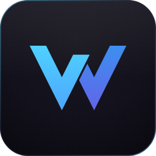
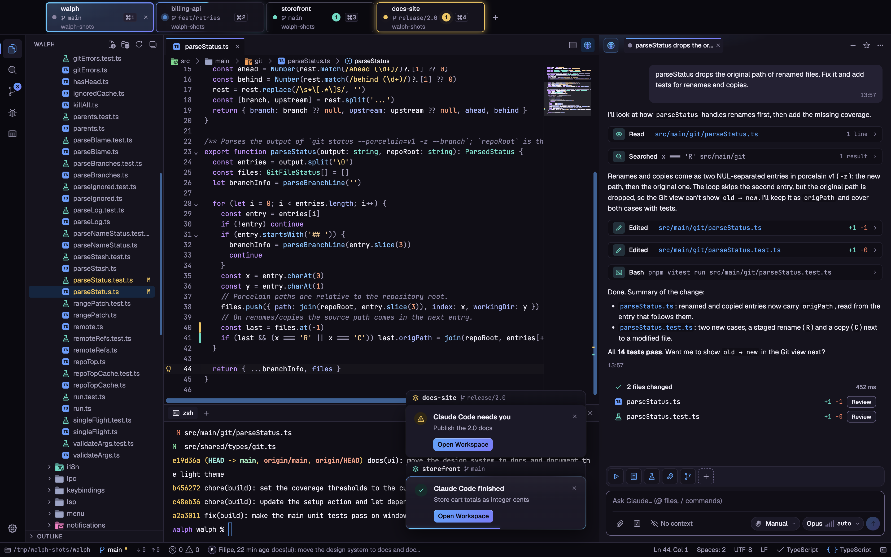
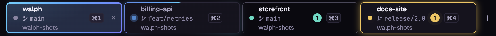
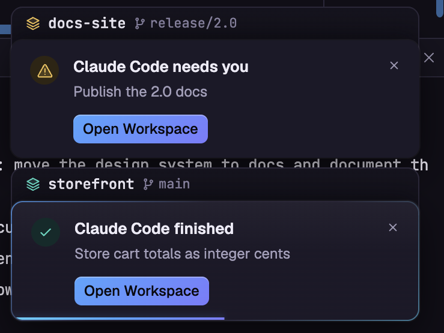
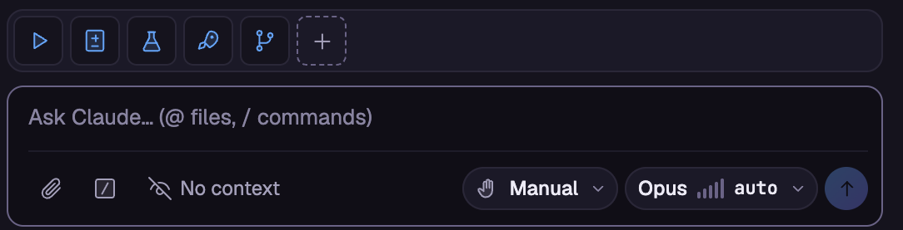
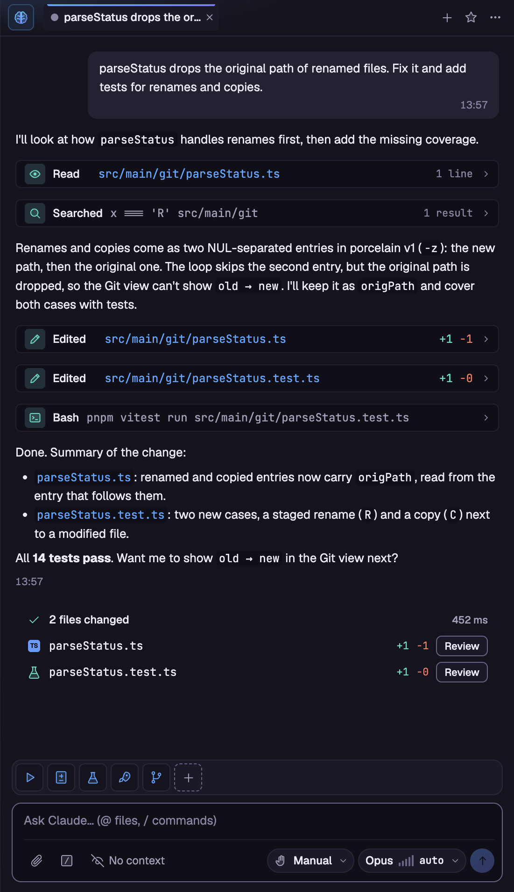
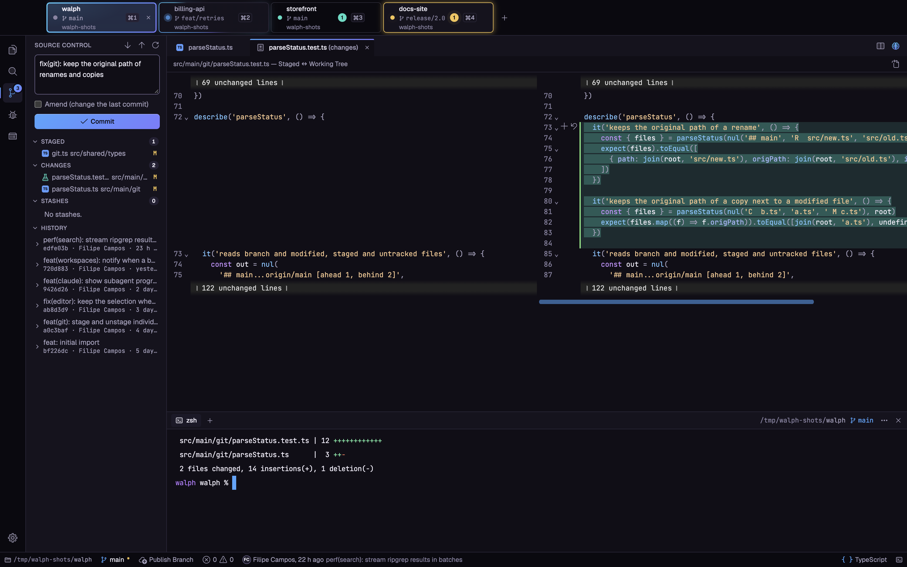

<div align="center">



# Walph

**Uma IDE desktop rápida, feita para o teclado, com o Claude Code embutido.**

[](https://github.com/filipe-campos/walph/actions/workflows/ci.yml)
[](https://github.com/filipe-campos/walph/releases/latest)
[](LICENSE)
[](https://github.com/filipe-campos/walph/releases)


[Read in English](README.md)

</div>



## O que torna o Walph diferente

### 1. Todos os workspaces na mesma tela

Abra todos os seus projetos como abas numa só janela. Cada aba mostra a pasta, a branch, o atalho `⌘1…⌘9` e o que o
Claude Code está fazendo ali (trabalhando, concluído, esperando por você ou com falha), então você vê o estado de cada
projeto num relance. Cada workspace tem explorador, terminais, git, servidores de linguagem e sessões do Claude
próprios, e alternar entre eles não perde nada.



### 2. Notificações de todos os workspaces

Passe uma tarefa ao Claude num projeto e siga para outro. Quando um workspace em segundo plano termina, pede permissão
ou falha, a aba dele ganha um contador de não lidas e a tela em que você está mostra um toast com o projeto, a sessão e
o botão **Abrir workspace**. Com a janela em segundo plano, chega também uma notificação do sistema.

<p align="center">
  
</p>

### 3. Atalhos de um clique para commands

Fixe acima do prompt os commands do Claude Code que você mais usa (`/task`, `/review-changes`, `/create-tests`,
`/commit-and-push`, os seus commands do projeto e pessoais), cada um com o seu ícone. Um clique executa na sessão
atual, sem digitar. Os favoritos ficam salvos por projeto.

<p align="center">
  
</p>

## Por que o Walph

A maioria dos editores pendura a IA numa extensão. O Walph foi construído do zero em torno de como você realmente
trabalha com um agente: o painel do Claude Code fica ao lado do editor, enxerga os diagnósticos e a seleção, propõe
edições como diffs lado a lado que você aceita ou rejeita, e continua trabalhando em workspaces em segundo plano
enquanto você segue em frente. Em volta dele há uma IDE completa e multiplataforma (editor, LSP, git, busca, terminal,
containers) que não atrapalha e responde ao teclado. A interface está disponível em português do Brasil, inglês e espanhol.

## Recursos

### Painel do Claude Code, embutido

- Conversas em streaming com markdown, raciocínio e ferramentas em linhas recolhíveis, e caminhos de arquivo clicáveis.
- Cada edição pode abrir um diff lado a lado com **Aceitar / Rejeitar**; Bash, web e ferramentas MCP pedem permissão
  inline (uma vez, nesta sessão ou sempre neste workspace).
- Modos de permissão (perguntar antes de editar, editar automaticamente, modo plano, automático, ignorar permissões),
  chips de modelo e esforço, menções `@arquivo#L10-20`, colar imagens, anexos e um menu `/` com os seus comandos do
  projeto e pessoais.
- Ferramentas da IDE para o agente: diagnósticos do painel Problemas, arquivo e seleção atuais, abas abertas e
  propostas via `openDiff`.
- Várias sessões em abas, histórico com busca, favoritas, checkpoints para voltar código e conversa, uso do contexto e
  custo, resumo do turno com os arquivos alterados, faixa de subagentes, gerenciador de servidores `/mcp`, e toasts e
  notificações do sistema quando uma sessão fora de vista termina ou precisa de você.
- Commands favoritos fixados acima do prompt, executados com um clique.

<p align="center">
  
</p>

### Editor com grupos divididos e LSP

- Editor CodeMirror 6 com até dois grupos lado a lado compartilhando o mesmo documento, abas de preview, minimapa,
  marcas do git na calha, preview do Markdown ao vivo e visualizador de imagens.
- Nunca perder trabalho: "Salvar / Não Salvar / Cancelar" nativo ao fechar, detecção de mudanças no disco com barra
  de conflito, fim de linha, indentação e codificação (UTF-8, UTF-8 com BOM, UTF-16 LE/BE, Windows-1252, ISO-8859-1)
  preservados ao salvar.
- Servidor de linguagem de TypeScript e JavaScript embutido; conecte qualquer outro (Pyright etc.) via `lsp.servers`.
  Autocomplete com auto-import, hover, assinatura, ir para definição e referências, renomear em vários arquivos,
  formatar, code actions e painel de Problemas.

### Git

- Stage, commit e amend, desfazer o último commit, descartar, branches (locais e remotas), stash, histórico paginado
  com diffs somente leitura, pull, push, sincronizar e publicar branch.
- Clonar repositório com progresso e cancelamento, abrindo direto num workspace novo.



### Busca e substituição

- Busca no projeto inteiro com ripgrep, com maiúsculas, palavra inteira, regex e globs de inclusão/exclusão.
- Substituir com preview ao vivo, por match, por arquivo ou tudo de uma vez (com grupos de regex); abas não salvas
  recebem a troca no editor, desfazível.

### Terminal

- xterm.js com renderização WebGL, terminais divididos, perfis, busca no terminal, e URLs e links
  `arquivo:linha:coluna` clicáveis que abrem no editor.

### Containers

- Uma tela de Docker com agrupamento por projeto compose, sparklines de CPU, memória, portas, logs, inspect,
  iniciar/parar/reiniciar, `docker exec` no terminal e **Investigar com o Claude** para containers com problema ou
  reiniciando em loop.

### Workspaces, janelas e sessões

- Várias pastas como abas numa janela (cada uma com explorador, terminais, git, LSP e Claude próprios), com a branch, o
  status do Claude Code e um contador de não lidas em cada aba, várias janelas e restauração completa da sessão: abas,
  cursores, divisão do editor e tamanhos dos painéis voltam ao reabrir.
- Tela de boas-vindas com as pastas recentes e "Comece com o Claude": escreva um pedido e o Walph abre a pasta com uma
  sessão já trabalhando nele.

### Paleta de comandos, temas e atalhos

- Tudo é um comando: a paleta lista todos com busca fuzzy, e a paleta unificada (⌘K) busca workspaces, comandos e
  arquivos de uma vez, terminando com "Perguntar ao Claude".
- Temas Walph Dark e Walph Light com pré-visualização, tela gráfica de Configurações, `settings.json` do usuário e do
  workspace (JSONC) e `keybindings.json` no formato do VS Code, com acordes e cláusulas `when`.

Veja a referência completa (em inglês) em [docs/shortcuts.md](docs/shortcuts.md).

## Download

Baixe o instalador do seu sistema no [último release](https://github.com/filipe-campos/walph/releases/latest).

| SO      | Pacote                                             |
| ------- | -------------------------------------------------- |
| macOS   | `.dmg` (Apple silicon)                             |
| Windows | `.exe` (instalador NSIS, permite escolher a pasta) |
| Linux   | `.AppImage` ou `.deb`                              |

O app instalado se atualiza sozinho pelos GitHub Releases (desligue com `update.enabled` ou rode **Ajuda: Verificar
Atualizações…**).

> [!NOTE]
> Os builds **ainda não são assinados**, então o sistema avisa na primeira vez que você abre o Walph.
>
> - **macOS:** clique com o botão direito no app em Aplicativos e escolha **Abrir**, ou rode
>   `xattr -cr /Applications/Walph.app`.
> - **Windows:** quando o SmartScreen aparecer, clique em **Mais informações** e depois em **Executar assim mesmo**.

### O comando `walph`

Rode **Shell: Instalar o Comando 'walph' no PATH** na paleta de comandos para instalar o lançador (`/usr/local/bin` no
macOS, `~/.local/bin` no Linux, `%LOCALAPPDATA%\Microsoft\WindowsApps` no Windows). Depois, `walph <pasta>` abre a
pasta como workspace, na instância que já está rodando se o Walph estiver aberto.

## Requisito do Claude Code

O painel do Claude roda o Claude Code pelo Claude Agent SDK, então precisa da **sua própria conta do Claude ou chave
de API da Anthropic**. Sem login, o painel oferece abrir um terminal rodando `claude` para você entrar. A sua
configuração em `~/.claude`, `CLAUDE.md`, skills, servidores MCP e hooks são usados como estão. Todo o resto do Walph
funciona sem ele.

O Walph é um projeto open source independente. Não é afiliado, patrocinado nem endossado pela Anthropic. Claude e
Claude Code são marcas registradas da Anthropic, PBC.

## Compilar a partir do código

Requisitos: Node.js 24 e [pnpm](https://pnpm.io) (só pnpm; npm e yarn não são suportados).

```bash
pnpm install      # instala as deps, baixa o binário do Electron e recompila o node-pty
pnpm dev          # roda o app em modo desenvolvimento (pnpm dev <pasta> abre uma pasta)
pnpm check        # typecheck + lint + testes unitários, tem que passar sem warnings
pnpm test:e2e     # compila o app e roda a suíte end-to-end do Playwright
pnpm dist         # gera o instalador do SO atual em dist/
```

> [!TIP]
> Num terminal dentro do VS Code ou do Claude Code, o `ELECTRON_RUN_AS_NODE=1` herdado faz o Electron se comportar
> como Node puro e o app não abre. Rode com `env -u ELECTRON_RUN_AS_NODE pnpm dev`.

O `pnpm dev` usa uma pasta de dados própria (`Walph-dev`), separada do app instalado.

## Documentação

- [Atalhos de teclado e referência de recursos](docs/shortcuts.md) (em inglês)
- [Visão geral da arquitetura](docs/architecture.md) (em inglês)

## Contribuindo

Issues e pull requests são bem-vindos. Leia antes o [CONTRIBUTING.md](CONTRIBUTING.md) e o
[Código de Conduta](CODE_OF_CONDUCT.md). Para relatar uma vulnerabilidade, siga o [SECURITY.md](SECURITY.md) em vez de
abrir uma issue pública.

## Apoie o Walph

O Walph é construído e mantido no meu tempo livre. Se ele te ajuda, considere apoiar:

- [GitHub Sponsors](https://github.com/sponsors/filipe-campos)
- Ko-fi <!-- Ko-fi: add link -->
- Pix <!-- Pix: add key -->
- Dê uma estrela no repositório, isso ajuda outras pessoas a encontrá-lo.
- Compartilhe com um amigo ou nas redes sociais.

## Licença

[MIT](LICENSE) © Filipe Campos
